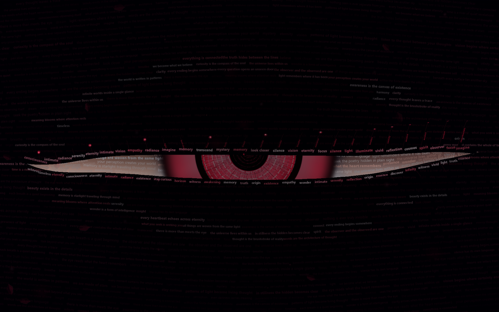
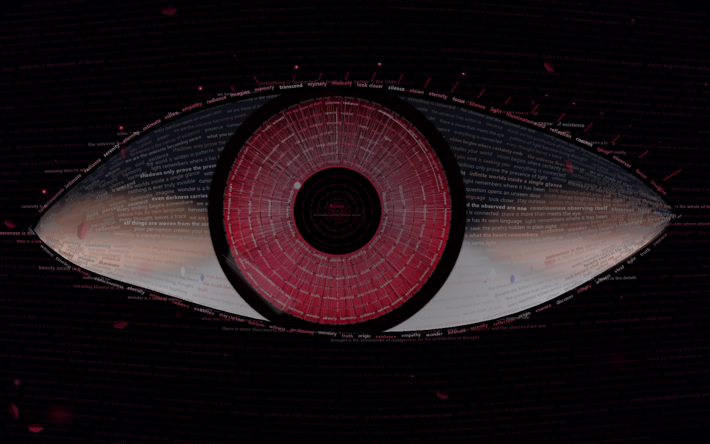
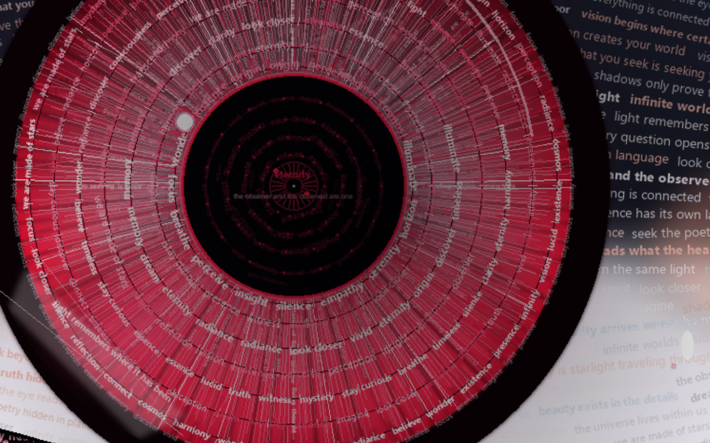
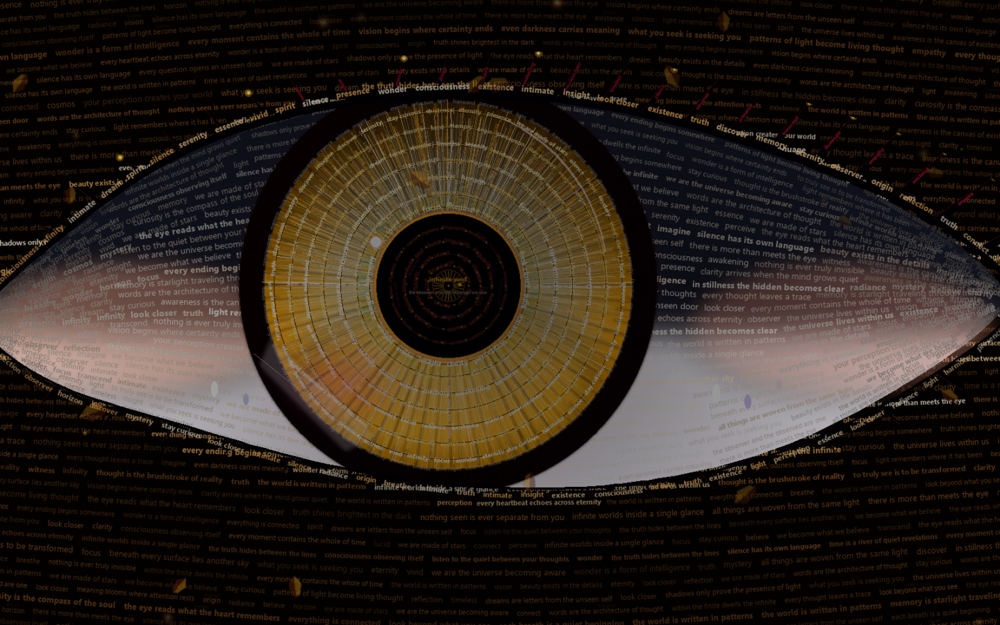

<div align="center">

# 👁️ OBSERVER
### *The Eye Within Words — Generative Typography & Sentient Consciousness Artwork*

[](https://www.python.org/)
[](https://pyga.me/)
[](LICENSE)
[]()
[]()

<br/>

> *"The eye is not surrounded by words.*  
> ***The eye is made from them.***  
> *Text &rarr; Structure &rarr; Thought &rarr; Consciousness &rarr; Eye."*

<br/>

</div>

---

## 🌌 Overview

**The Eye Within Words** is an edge-to-edge generative typography art installation written entirely in pure Python. Every single element on screen—from the limbal ring and radial iris fibers to the eyelid contours, corneal highlights, and distant atmospheric fields—is constructed from readable philosophical thoughts, quotes, and poetic fragments.

It is not merely a visual effect; the artwork possesses an internal **Consciousness Engine** that breathes, shifts through emotional mind states, adapts to viewer attentiveness, responds dynamically to the observer's cursor with biological ocular latency, and undergoes profound cinematic revelations.

---

## 📸 Visual Showcase

<div align="center">

### 1. The Cinematic Opening (The Spark of Genesis)
*From the primordial dark void, faint whispers emerge, an ember spark pulses, and language constructs the eye.*
<br/>


<br/><br/>

### 2. Crimson Requiem (Wide Living Composition)
*The full living entity gazing across the infinite edge-to-edge canvas of human thought.*
<br/>


<br/><br/>

### 3. The Eyeball Singularity (Macro Close-Up)
*Close-up inspection reveals the secret: iris fibers are streams of micro-words, while the pupil reveals recursive event horizons.*
<br/>


<br/><br/>

### 4. Solar Flare (Molten Gold & Amber Awakening)
*Shifting through the Consciousness Engine into radiant incandescent gold and amber.*
<br/>


</div>

---

## ✨ Core Features & Visual Systems

### 1. The Iris Made of Language (5 Fiber Archetypes)
At ordinary viewing distance, the iris presents rich, biological depth. Zooming into the eyeball reveals that every individual fiber is woven from language:
- **Archetype A (Organic Structural Fibers)**: 160 curved Bezier fibers providing foundational biological volume.
- **Archetype B (Repeated Micro-Word Streams)**: 84 radial word streams (*"truth"*, *"light"*, *"thought"*, *"memory"*, *"vision"*, *"cosmos"*, *"awake"*, *"eternal"*).
- **Archetype C (Radial Sentence Tracks)**: 32 philosophical sentence fragments following radial stromal axes.
- **Archetype D (Broken Ancient Glyphs)**: 48 weathered crypt valleys with irregular lacunae, evoking ancient imperfection.
- **Archetype E (Radiant Laser Filaments)**: 36 high-intensity electric crimson and white-hot light filaments.
- **Collarette Word-Teeth**: Anchoring spires bearing *"observe"*, *"witness"*, *"awake"*, *"pure"*, *"origin"*, *"vision"*.
- **Limbal Inscription Ring**: A circumscribed circular quote framing the iris against the dark universe.

### 2. Translucent Cornea & 3D Spherical Parallax
- **Upper Mirrored Highlight**: Inverted reflection carrying *"memory is light traveling through thought"*.
- **Lower Refraction Glare**: Micro-inscription carrying *"light remembers where it has been"*.
- **3D Dome Curvature**: Specular highlights curve and foreshorten naturally across the eyeball sphere:
  $$\text{sphere\_curve} = \max\left(0.65, 1.0 - \left(\frac{d}{2.2 \cdot r_{\text{iris}}}\right)^2\right)$$

### 3. The Infinite Pupil Abyss
- The pupil is not an empty black circle—it is an event horizon of infinite depth.
- **Distant Signal Fragments**: Faint words (*"observer"*, *"you see"*, *"remember"*, *"awareness"*, *"infinite"*, *"why"*) drift deep within the obsidian singularity.
- **Celestial Inner Eye Nebula**: 4 concentric event horizons inscribed with rotating aperture poetry around a central starlight core (*"the observer and the observed are one"*).

### 4. Living Eye Tracking & Viewer Attentiveness
- **Biological Saccadic Movement**: Decoupled from camera panning, the eyeball tracks the viewer's mouse smoothly and decisively with organic mass (~110ms settling time).
- **Persistent Gaze Fixation**: When the cursor stops, the eye remains focused directly on the cursor, maintaining living micro-saccades (`~1.5px`) rather than abandoning the viewer.
- **Attentiveness Feedback**: Rapid mouse movement elevates the eye's alertness (pupil dilates $+8\%$, collarette glow brightens). Prolonged stillness allows the eye to relax into a meditative half-drowse and autonomous Lissajous contemplation.

### 5. The 19.5s Cinematic Genesis Opening
Upon launch, reality unfolds through a 5-phase genesis sequence:
1. **0.0s – 4.0s (The Void)**: Near-pitch darkness; faint whispering words (15% opacity) drift in silence.
2. **4.0s – 8.5s (The Spark)**: A glowing crimson ember spark pulses at the pupil center; background words warm into visibility.
3. **8.5s – 13.5s (Genesis)**: Iris fibers construct themselves outward; eyelid slowly opens to 0.6x; background illuminates to 90%.
4. **13.5s – 17.0s (Unveiling)**: The pupil void expands open; eyelid opens wide (1.0x); background achieves full brilliance.
5. **17.0s – 19.5s (First Contact)**: Gaze locks onto the cursor, executes its first biological blink, and awakens into full consciousness.

### 6. The 9-Phase "Impossible Moment" Sacred Sequence (Key `M`)
A 13.5-second cinematic sacred sequence that can be triggered at any time:
- **Phase 1 (Silence)**: Deceleration of reality; eye locks dead-center.
- **Phase 2 (Focus)**: Pupil contracts with razor sharpness ($0.68\times$).
- **Phase 3 (Stillness)**: The entire universe freezes; particles and text halt.
- **Phase 4 (Revelation)**: A sacred sentence glows in pure silver above the collarette.
- **Phase 5 (Singularity Opens)**: The pupil opens into an immeasurable abyss ($1.26\times$).
- **Phase 6 (Disintegration)**: The sentence fragments into floating letters and glowing embers.
- **Phase 7 (Gravity of Meaning)**: Letter-particles are gravitationally pulled into the pupil singularity.
- **Phase 8 (Cosmic Blink)**: Total biological darkness; takes a retinal afterimage snapshot.
- **Phase 9 (Rebirth)**: The eye opens; the retinal afterimage lingers and slowly decays over 2 seconds.

---

## 🕹️ Interactive Controls

| Key / Input | Action |
| :---: | :--- |
| **`Mouse Move`** | Direct, living gaze tracking with eyelid articulation and 3D corneal reflection |
| **`M`** | **Trigger the 9-Phase "Impossible Moment" Sacred Journey** |
| **`SPACE`** | Trigger an instant biological blink with micro-asymmetrical eyelids |
| **`B`** | Toggle automatic biological blinking on / off |
| **`Z`** | Toggle automatic cinematic camera zoom ($1.0\times$ wide &harr; $2.4\times$ macro zoom) |
| **`C`** | Cross-fade smoothly between color palettes (1.8s fluid transition) |
| **`W`** | Trigger the synchronized "Cosmic Awareness" expansion wave |
| **`R`** | Regenerate typography arrangement, quote distributions, and fiber seeds |
| **`H`** | Show / hide HUD diagnostic overlay (live FPS, Mind State, Attentiveness %) |
| **`ESC`** | Gracefully exit the installation |

---

## 🎨 Color Palettes & Emotional Mind States

Cycle through 5 distinct atmospheric themes by pressing **`C`**:
1. **Crimson Requiem**: Anime Blood Ruby, Deep Scarlet, Porcelain Sclera & Obsidian.
2. **Midnight Eclipse**: Deep Neon Cyan, Electric Blue, Starlight Indigo & Void.
3. **Bioluminescent Monarch**: Abyssal Jade, Turquoise, Mint Spores & Deep Emerald.
4. **Astral Sovereign**: Amethyst, Royal Purple, Lavender Glow & Deep Space.
5. **Solar Flare**: Molten Gold, Incandescent Amber, Warm Ivory & Sunburst.

---

## 🚀 Setup & Installation

### 1. Prerequisites
- **Python 3.10+** (Python 3.10, 3.11, 3.12, 3.13, 3.14 supported).
- Compatible with **Windows**, **macOS**, and **Linux**.

### 2. Clone the Repository
```bash
git clone https://github.com/Raj-AI-Tech/Observer.git
cd Observer
```

### 3. Create & Activate a Virtual Environment

**Windows (PowerShell):**
```powershell
python -m venv .venv
.\.venv\Scripts\Activate.ps1
```

**macOS / Linux:**
```bash
python3 -m venv .venv
source .venv/bin/activate
```

### 4. Install Dependencies
```bash
pip install pygame-ce pillow numpy
```
*(Note: `pygame-ce` [Community Edition] is recommended for optimal rendering performance).*

### 5. Run the Installation

**Standard Windowed Mode (Resizable):**
```bash
python eyes.py --windowed
```

**Borderless Fullscreen Mode (Recommended for maximum immersion):**
```bash
python eyes.py
```

---

## 📂 Project Structure

```
Observer/
│
├── eyes.py              # Main application source code & rendering pipeline
├── screenshots/         # High-resolution artwork captures
│   ├── 1_cinematic_opening.png
│   ├── 2_wide_red_eye.png
│   ├── 3_only_eyeball.png
│   └── 4_yellow_eye.png
├── README.md            # Comprehensive project documentation
└── .gitignore           # Git ignore rules for virtual environments and cache
```

---

## ⚡ Performance Architecture

- **Precomputed Layer Compositing**: All high-resolution typography layers (sclera, radial word fibers, collarette teeth, limbal inscription) are pre-rendered into dedicated PIL alpha surfaces during initialization, keeping runtime per-frame rendering cost virtually zero.
- **Hardware-Accelerated Blending**: Real-time elements (corneal glares, glowing embers, eyelid ribbons, afterimages) use Pygame's accelerated `BLEND_RGBA_ADD` and `BLEND_RGBA_MULT` modes.
- **Rock-Solid 60 FPS**: Maintains a silky-smooth 60 frames per second on modern consumer laptops and desktops.

---

## 📜 License

This project is open-source and released under the **MIT License**. You are free to use, modify, and distribute it for personal, artistic, and educational purposes.

<div align="center">

*“We are the universe becoming aware of itself.”*

</div>
